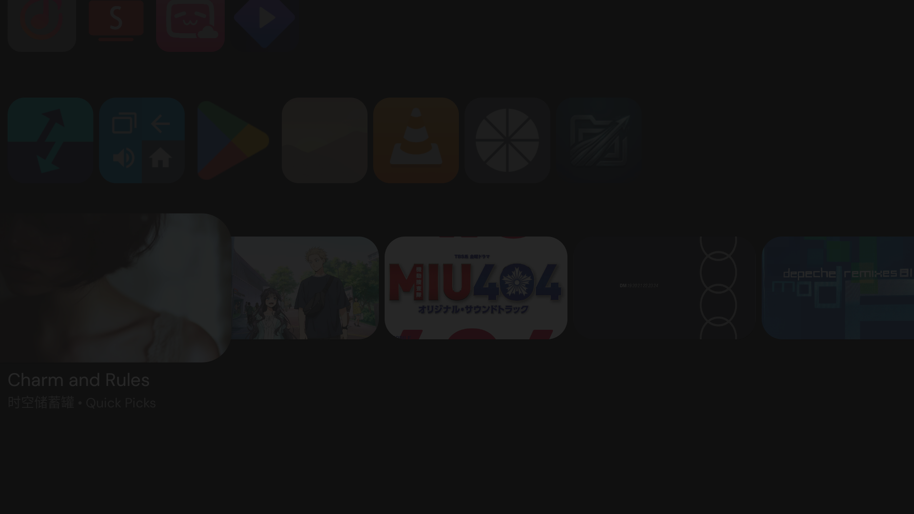

# Android TV preview compatibility

Checked 2026-11-04 on a Chromecast (`sabrina`, Android 14) with Projectivy 4.73 installed. The [official GitHub release list](https://github.com/spocky/miproja1/releases) lists 4.72 as its latest release; no newer GitHub build was available to install.

AuraMusic's channel is visible on the Projectivy home screen and contains Quick Picks. The service logged 10 published programs, updated in place on refresh. With the normal build, focusing a card enlarges its artwork. AuraMusic publishes poster and thumbnail artwork only; it does not set either preview URI.

Projectivy 4.51 added hover video previews for supported cards and a policy setting (`never`, `always`, or `only when no media is currently playing`) ([release notes](https://github.com/spocky/miproja1/releases/tag/4.51)). The current device setting was not changed during this CLI-only test. Android TV's [preview video API](https://developer.android.com/training/tv/discovery/preview-videos) accepts a publicly accessible HTTPS URI and allows audio or video media. Projectivy's public repository contains configuration and theme tooling, not its launcher implementation. Direct `previewAudioUri` support remains unverified; the muxed `previewVideoUri` path below is the one that played audio.

## Chromecast focus-preview experiments

Tests ran on 2026-11-04 with AuraMusic 3.2.0 debug, Chromecast (`sabrina`, Android 14), and Projectivy 4.73. The channel had 10 programs. Tests used only D-pad movement and focus waits; no card was selected during preview checks. AuraMusic's media session stayed paused. We resolved audio-only URLs for the visible “Chrysopoeia” and “Lilypad” cards and tried both provider fields:

- `previewAudioUri`: focused each card for about 15 seconds, then moved between them. Projectivy PID 1417 created no audio player or media session; AuraMusic remained paused.
- `previewVideoUri` containing the same audio-only URL: repeated after force-stopping and reopening Projectivy to discard its in-memory card cache. No audio player or media session appeared during focus waits. Audio-only preview behavior is therefore not demonstrated on Projectivy 4.73.
- Muxed `previewVideoUri`: a test-only update published 360p muxed H.264/AAC URLs for adjacent `Chrysopoeia` and `Lilypad` cards, then Projectivy was force-stopped and reopened. D-pad focus on `Chrysopoeia` started a Projectivy-owned 44.1 kHz `AudioTrack` (UID 10150/PID 27697). Moving right to `Lilypad` paused, stopped, and released that player, then started a new Projectivy audio track. The user confirmed the first two focused cards played different songs. AuraMusic's own MediaSession remained paused throughout. No card was selected, so this verifies focus-driven song-to-song playback, not launch-on-click behavior.
- The preview card still showed static artwork; no visible video motion or soundbar animation appeared. Projectivy logs showed both AVC and HEVC decoder activity during the experiment, so the exact URI/codec it consumed is not fully established. Earlier muxed tests also showed `NoSupport [codec.profileLevel, hvc1.2.4.L123.B0, video/hevc]` and decoder reclamation. The launcher hover setting and whether the selected YouTube stream contains moving frames remain open checks.
- To separate stream content/codec from launcher behavior, a temporary build published a locally served 10-second silent H.264 Baseline 640×360 test clip as every program's `previewVideoUri`. With D-pad focus on “Black Sheep,” Projectivy fetched the clip (`HTTP 200`) and created an AVC decoder, but the card continued showing its poster. Two screenshots two seconds apart had no changed pixels in the focused-card area. No card was selected. This rules out a YouTube stream or HEVC-only explanation for the missing animation; Projectivy's hover-video policy or its channel-card renderer remains the likely gate, but the current private setting is unknown.
- AuraMusic's local records mark these two songs `isVideo = false`; they are audio-track recommendations, not music-video items. This may explain why the video URI did not visibly animate, but the resolver still returned muxed streams, so it is not a confirmed cause.

The H.264 request is only a resolver preference: `AuraVideo.getVideoStreamSource` may fall back to another codec, returns a sanitized container MIME, and exposes no URL expiry. A provider duration cannot enforce a 15–30 second cutoff. These limits prevent safely publishing the tested direct stream URL as a durable recommendation preview without additional expiry/re-resolution handling. The temporary local test URI was removed from source; production APK was rebuilt/reinstalled and the service republished 10 cards (`0 added, 10 updated, 0 removed`). Install time and app data were preserved.

A separate card-selection check opened AuraMusic to the chosen song. That was a click-launch check and does **not** count as a hover preview. The hover result above came only from D-pad focus changes. Refresh logic explicitly writes null preview URIs in the production build so stale URIs cannot survive reconciliation. Projectivy stops its preview player on focus loss in this test; visual animation/video, freshness/expiry, and a durable preview URI strategy remain unimplemented or unverified.

## Refresh cadence limitation

Quick Picks use a four-hour rotation seed, but the TV source has no periodic refresh worker. Current refresh triggers are TV activity creation, playback item/state changes, and device boot. The rotation only takes effect when one of those events triggers a publish; if AuraMusic stays closed and playback is stopped, the row can remain unchanged indefinitely. A periodic implementation should publish through a background worker rather than launch the current `mediaPlayback` foreground service from an inexact alarm. Android recommends WorkManager for deferrable periodic work ([background work guidance](https://developer.android.com/develop/background-work/services/alarms), [foreground-service background-start restrictions](https://developer.android.com/develop/background-work/services/fgs/restrictions-bg-start)).
